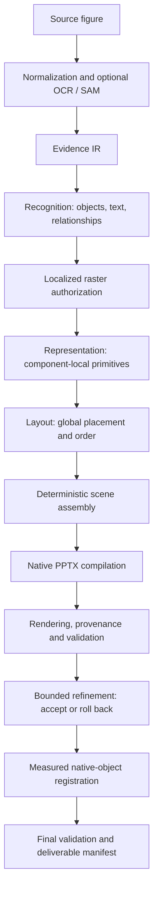

# Decomposer

Decomposer converts a scientific figure into an **editable, single-slide PowerPoint presentation**. Vision models describe the figure through structured JSON; deterministic code assembles the scene, writes native PowerPoint objects, and checks the exported file. Rendered runs can also refine and calibrate the native objects through measured, reversible changes.

The repository contains the framework, prompts, schemas, adapters, configuration templates, and synthetic development examples. It contains no research datasets, annotations, model weights, historical knowledge snapshots, experimental outputs, or evaluation results.

## Contents

- [Architecture](#architecture)
- [Repository layout](#repository-layout)
- [Installation](#installation)
- [Quick start without a model](#quick-start-without-a-model)
- [Configure a real run](#configure-a-real-run)
- [Run on your own figure](#run-on-your-own-figure)
- [Outputs and run status](#outputs-and-run-status)
- [Troubleshooting](#troubleshooting)
- [Development](#development)
- [License](#license)

## Architecture

The generation pipeline separates **what an object is**, **how it is represented**, and **where it is placed**. Each stage has a defined ownership boundary; models propose JSON while the framework owns execution and serialization.



| Stage | Responsibility | Main source |
| --- | --- | --- |
| Observations and evidence | Normalize the source image, collect optional detector candidates, and record evidence for subsequent stages | `detectors.py`, `evidence.py` |
| Recognition | Identify objects, source text, categories, source bounds, and connector relationships | `recognition.py` |
| Asset authorization | Decide whether a bounded leaf can use a localized raster crop | `asset_policy.py` |
| Representation | Describe component-local shapes, paths, text, styles, and approved assets; support standard, compact, or sharded generation | `representation.py`, `representation_compact.py`, `representation_shards.py` |
| Layout | Specify global position, size, rotation, text scale, and stacking order | `layout.py` |
| Assembly and compilation | Combine local primitives with global layout and serialize native PowerPoint objects | `assemble.py`, `pptx.py`, `polygons.py`, `backend/compile.mjs` |
| Validation and provenance | Check structure, editable text identity, shape ownership, and rendered similarity when available | `validation.py`, `provenance.py`, `quality.py` |
| Refinement | Diagnose a focused issue, apply an owner-scoped declarative patch, and accept or roll back the candidate | `refinement.py` |
| Registration | Apply bounded, measured corrections to native text, fill, panels, shadows, tracking, and style | `*_registration.py` |
| Knowledge lifecycle | Record evidence and retrieve bounded guidance for refinement | `knowledge.py`, `evolution.py` |

Python module paths in this table are relative to `decomposer/` unless a directory is shown.

### Execution contracts

- **JSON proposals:** models return structured stage proposals. The deterministic compiler writes PPTX and DrawingML.
- **Editable objects:** shapes and non-equation text use native PowerPoint objects. Authorized irreducible leaves, such as photographs, may use localized images. Screenshot-like whole-page substitution is blocked.
- **Traceability:** object labels and primitive IDs connect the stage outputs to scene elements and exported shapes.
- **Measured repair:** refinement candidates are compiled and rendered before acceptance. Rejected candidates do not replace the accepted output. Registration passes have their own bounded acceptance and rollback checks.
- **Knowledge boundary:** Recognition, Representation, and Layout receive no runtime memories. Only Refinement retrieves knowledge. The default configuration starts with an empty, per-run knowledge store.

See [the detailed architecture](docs/architecture.md) and [adapter contracts](docs/adapters.md).

## Repository layout

```text
Decomposer/
├── run.py                     # CLI entry point and config overlay
├── decomposer/                # Pipeline, schemas, stages and validation
├── backend/compile.mjs        # Deterministic PptxGenJS compiler
├── adapters/                  # Reference vision-model transport
├── prompts/                   # Stage instructions and Representation variants
├── configs/
│   ├── base.json              # Portable pipeline configuration
│   ├── macos-ocr.json         # Optional Apple Vision OCR override
│   └── models/                # Model transport templates
├── examples/                  # Locally generated geometric example
├── tools/                     # OCR, knowledge audits and snapshot verification
├── tests/                     # Synthetic and mocked framework checks
├── docs/                      # Architecture, interfaces and release scope
├── requirements.txt           # Python runtime dependencies
├── requirements-dev.txt       # Development dependencies
└── package-lock.json          # Locked Node.js dependencies
```

## Installation

### 1. Install prerequisites

| Dependency | Used for | Required when |
| --- | --- | --- |
| Python 3.10+ | Pipeline, image processing, validation and adapters | Every run |
| Node.js 18+ and npm | Native PPTX compilation with PptxGenJS | Every run |
| LibreOffice, exposing `soffice` | Convert PPTX to PDF for rendering | Rendered runs |
| Poppler, exposing `pdftoppm` | Convert rendered PDF to an image | Rendered runs |
| Fonts matching the source figure | Native text rendering | Text-containing rendered runs |
| A vision-capable model service or configured Codex CLI | Generate stage proposals | Model-backed runs |
| An OCR or SAM adapter | Optional detector observations | Only when enabled |

Install the system tools using your platform's package manager or installer. The framework does not bundle executables, model services, detector weights, or fonts. PowerPoint itself is not required to compile the presentation.

### 2. Clone and install project dependencies

Use an account with access to this repository:

```bash
git clone https://github.com/goya4140/Decomposer.git
cd Decomposer

python3 -m venv .venv
source .venv/bin/activate
python -m pip install -r requirements.txt
npm ci
```

Confirm that `python3` is Python 3.10 or newer before creating the virtual environment. The shell examples below use bash/zsh on macOS or Linux. Run commands from the repository root with the virtual environment activated; relative adapter and detector paths resolve from that directory.

### 3. Check the tools you need

```bash
python --version
node --version
npm --version
```

For rendered runs, also check:

```bash
soffice --version
pdftoppm -v
```

If a tool is installed outside PATH, set its absolute executable path in the local configuration described below. On macOS, LibreOffice's executable may be located inside its application bundle.

## Quick start without a model

After installing dependencies, generate a small geometric figure and matching JSON proposals locally:

```bash
python examples/make_synthetic_example.py --out runs/synthetic-input

python run.py \
  --input runs/synthetic-input/source.png \
  --config configs/base.json \
  --fixture-dir runs/synthetic-input/fixtures \
  --out runs/synthetic-smoke \
  --no-render
```

This exercises the pipeline with fixture proposals instead of model calls. It requires no API key or research input. `--no-render` compiles the PPTX and performs structural checks; it skips rendering, visual assessment, refinement, and measured registration.

To exercise rendering as well, ensure `soffice` and `pdftoppm` are available, then run:

```bash
python run.py \
  --input runs/synthetic-input/source.png \
  --config configs/base.json \
  --fixture-dir runs/synthetic-input/fixtures \
  --out runs/synthetic-render
```

The example includes a stop proposal for Refinement, so neither command needs a model service. It is an installation example, not an evaluation dataset.

## Configure a real run

### 1. Create a local runtime configuration

```bash
cp configs/base.json config.local.json
```

Edit the existing sections in `config.local.json`:

| Setting | Meaning |
| --- | --- |
| `runtime.node` | Node executable name or absolute path |
| `runtime.soffice` | LibreOffice executable name or absolute path |
| `runtime.pdftoppm` | Poppler executable name or absolute path |
| `runtime.timeout_seconds` | Timeout for compiler and rendering subprocesses |
| `model.timeout_seconds` | Timeout for a model stage |
| `detectors.ocr.command` / `detectors.sam.command` | Detector argument lists; `null` disables the detector |
| `refinement.max_rounds` | Maximum model-assisted refinement rounds; `0` disables this step |
| `refinement.knowledge_path` | `null` stores new knowledge under `<out>/knowledge`; an explicit path uses a shared user-managed store |
| `validation` | Acceptance thresholds applied by final validation |

The base configuration enables up to three refinement rounds and disables OCR/SAM. Setting `refinement.max_rounds` to `0` does not disable deterministic registration. Use `--no-render` to skip the entire rendered path.

`config.local.json` is ignored by Git. Keep credentials in process environment variables rather than configuration files.

### 2. Choose a model backend

#### OpenAI-compatible vision endpoint

The reference adapter sends Chat Completions requests containing the source image and stage prompt. Copy its profile to an ignored local file:

```bash
cp configs/models/openai-compatible.example.json config.model.local.json
```

Set the endpoint, model, and API key in the activated environment:

```bash
export MODEL_BASE_URL="https://your-provider.example/v1"
export MODEL_NAME="your-vision-model"
```

For bash, enter the key using:

```bash
read -r -s -p "API key: " MODEL_API_KEY
printf '\n'
export MODEL_API_KEY
```

For zsh, use:

```zsh
read -r -s 'MODEL_API_KEY?API key: '
printf '\n'
export MODEL_API_KEY
```

Run the key-entry command for your shell. The profile's `environment_allowlist` passes these named variables to the adapter. `MODEL_BASE_URL` should end at the API base path, such as `/v1`; the adapter appends `/chat/completions`.

The template requests `json_schema`. If the endpoint uses another output mode, change the value after `--response-mode` in `config.model.local.json` to `json_object` or `prompt_only`. The selected model must support image inputs and the requested response mode. Endpoint-specific limits can be configured through the adapter's command arguments; inspect them with:

```bash
python adapters/openai_compatible_vision.py --help
```

#### Codex CLI

Install and authenticate your Codex CLI separately, then copy the profile:

```bash
cp configs/models/codex.example.json config.model.local.json
```

Replace `YOUR_AVAILABLE_VISION_MODEL` with a model available to your account. Set `model.command` if `codex` is outside PATH. The transport supplies the image, schema, isolated workspace, and tool restrictions; the installed CLI must support the flags used in `decomposer/model.py`.

### 3. Optionally enable detector observations

OCR and SAM use subprocess adapters that receive a JSON request on stdin and return JSON candidates on stdout. Implementations and detector weights are supplied separately. See [the detector contract](docs/adapters.md#detectors).

For Apple Vision OCR on macOS, with Swift available, copy the `detectors.ocr` section from `configs/macos-ocr.json` into `config.local.json`:

```json
{
  "command": ["python3", "tools/apple_vision_ocr.py"],
  "timeout_seconds": 600,
  "options": {}
}
```

This JSON replaces the value of `detectors.ocr`, not the entire configuration. Keep `detectors.sam.command` as `null` unless you have configured a compatible SAM adapter.

## Run on your own figure

Use a local raster image readable by Pillow, such as PNG or JPEG:

```bash
python run.py \
  --input /absolute/path/to/figure.png \
  --config config.local.json \
  --model-profile config.model.local.json \
  --out runs/my-figure
```

Choose a new output directory for each independent figure or configuration. `--model-profile` recursively overlays its JSON on `--config`; unspecified base settings are retained. Although named a model profile, the overlay can contain other configuration sections.

To resume an interrupted run with the same input and configuration, repeat the command with `--resume`:

```bash
python run.py \
  --input /absolute/path/to/figure.png \
  --config config.local.json \
  --model-profile config.model.local.json \
  --out runs/my-figure \
  --resume
```

Resume checks completed canonical stages and model-call metadata before reuse. It recomputes from an invalid or incomplete stage. Use a fresh output directory when changing models or configuration; resume is not a configuration-change detector.

| Argument | Purpose |
| --- | --- |
| `--input` | Required source image path |
| `--config` | Required base/runtime JSON configuration |
| `--model-profile` | Optional recursive configuration overlay |
| `--out` | Required run output directory |
| `--fixture-dir` | Read stage proposals from local JSON fixtures instead of model calls |
| `--no-render` | Compile and inspect without rendering, visual refinement, or registration |
| `--resume` | Reuse valid completed stages in the output directory |

## Outputs and run status

A run records stage proposals and canonical outputs alongside the final deliverables:

```text
runs/my-figure/
├── status.json                # Terminal status or failure information
├── resume-report.json         # Stage reuse and recomputation decisions
├── input/                     # Normalized source and input identity
├── observations/              # Detector candidates and Evidence IR
├── calls/                     # Model requests, responses and metadata
├── recognition/               # Canonical recognized objects
├── representation/            # Components and asset decisions
├── layout/                    # Global placements
├── refinement/                # Decisions and candidate assessments
└── output/
    ├── editable.pptx          # Editable single-slide presentation
    ├── scene.json             # Assembled scene IR
    ├── report.json            # Compiler, structure and rendering report
    ├── provenance.json        # Object-to-export traceability
    ├── validation.json        # Final checks and failure details
    ├── page-manifest.json     # Deliverable manifest
    └── preview.png            # Present when rendering is available
```

Individual registration passes can also record their own directories. Their presence depends on the execution path. Run directories contain the user's own inputs and generated artifacts and are ignored by Git.

Inspect `status.json` and `output/validation.json` before using the deliverable:

| Status | Meaning |
| --- | --- |
| `structural_success` | Compilation and configured structural checks passed; rendering was skipped or unavailable |
| `render_success` | Rendering and the configured final validation checks passed |
| `validation_failed` | Final validation rejected the run; inspect failed checks |
| `runtime_failed` | A required stage or subprocess failed; inspect the recorded error and stage logs |

Also inspect `degraded`, compiler fallbacks, and warnings. The existence of a PPTX alone does not establish a successful run. The CLI can finish normally while reporting `validation_failed`; automation should read the JSON status rather than rely only on the process exit code.

## Troubleshooting

| Symptom | What to check |
| --- | --- |
| Compiler failure | Run `npm ci`; check `runtime.node` and `output/compile.log` |
| Missing preview or render failure | Check `soffice`, `pdftoppm`, their configured paths, timeout, and `output/render.log` when present |
| Adapter cannot find its script | Run from the repository root with the virtual environment active |
| Model authentication or request failure | Check environment variables, the profile allowlist, endpoint/model support, and `calls/<stage>/metadata.json` and `stderr.log` |
| Invalid model JSON | Check the provider's response-mode support and stage diagnostics; adjust the local profile rather than treating fallback content as a completed stage |
| OCR/SAM candidates unavailable | Inspect `observations/candidates.json` and detector stderr logs; disabled detectors are expected when their commands are `null` |
| Text renders differently | Install the appropriate fonts and verify the renderer environment |
| `validation_failed` | Read `output/validation.json` and inspect the preview and provenance before accepting the presentation |

## Development

Install the development dependencies and run the framework checks:

```bash
python -m pip install -r requirements-dev.txt
python -m pytest -q
```

Tests use generated inputs, fixtures, and mocked model responses. Compiler integration checks require Node.js and the npm dependencies; rendered checks require the system renderer. No model API credentials are required for the fixture example or framework checks.

For extending the framework, begin with [architecture](docs/architecture.md), [adapter interfaces](docs/adapters.md), and [release scope](docs/release-scope.md). Add a model or detector through its transport contract, while retaining the stage ownership, editable-text, raster-authorization, and rollback boundaries.

## License

Apache-2.0. See [LICENSE](LICENSE) and [NOTICE](NOTICE). Third-party dependencies retain their respective licenses.
