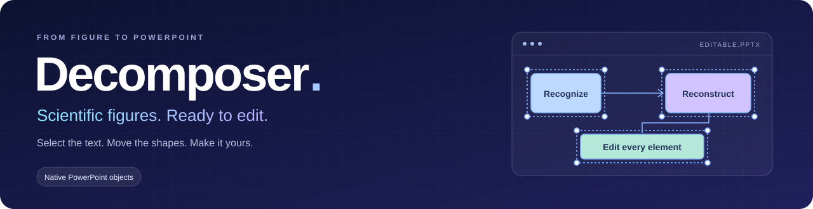
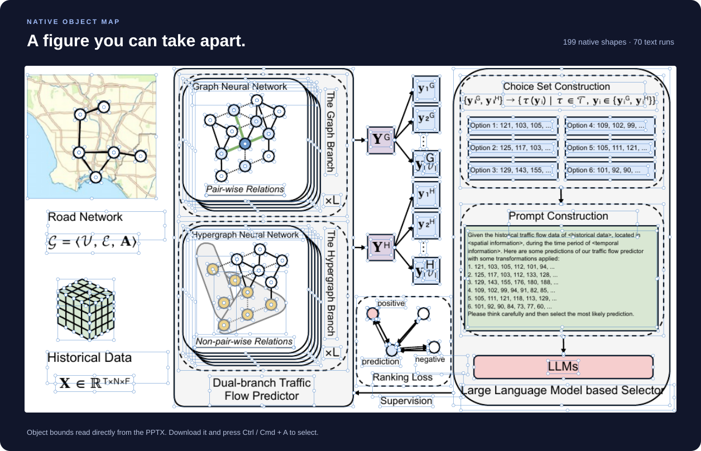
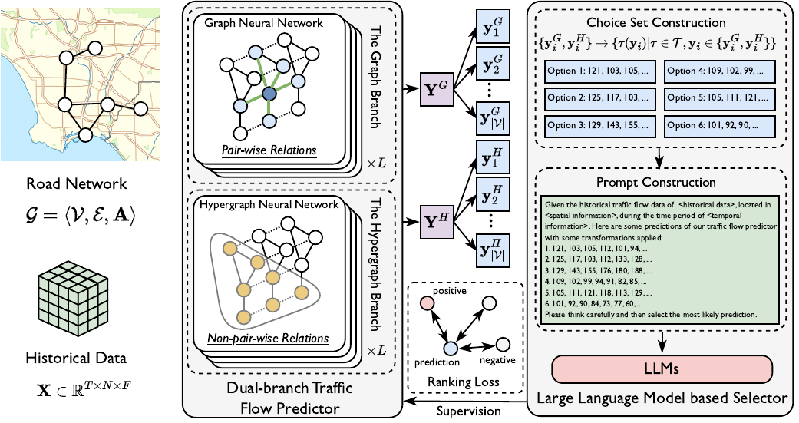
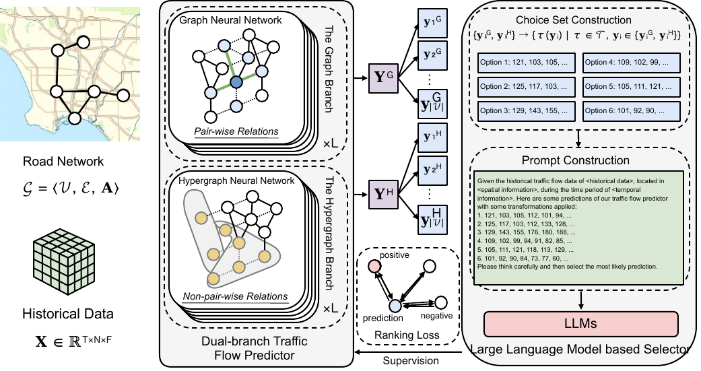

<p align="center"></p>

<p align="center"><b>English</b> · <a href="README.zh-CN.md">简体中文</a> · <a href="#start-with-docker">Quick start</a> · <a href="examples/editable-demo.pptx">Download demo PPTX</a></p>

### Select it. Move it. Make it yours.

[](examples/editable-demo.pptx)

Open the [demo PPTX](examples/editable-demo.pptx), click the slide canvas and press **Ctrl / Cmd + A**. Text, shapes and connectors remain individually selectable.

<details>
<summary>Original image → reconstructed PowerPoint</summary>

| Input image | Reconstructed PPTX |
| :---: | :---: |
|  |  |

</details>


## Start with Docker

Install Git, Docker and Docker Compose, then run:

```bash
git clone https://github.com/goya4140/Decomposer.git
cd Decomposer
cp .env.example .env
```

Set these three values in `.env` using a vision-capable API:

```dotenv
DECOMPOSER_BASE_URL=https://your-provider.example/v1
DECOMPOSER_API_KEY=your-api-key
DECOMPOSER_MODEL=your-vision-model
```

Use the API base URL without `/chat/completions`. If your provider does not support `json_schema`, set `DECOMPOSER_RESPONSE_MODE=json_object`.

Start:

```bash
./deploy.sh --docker
```

Open [http://127.0.0.1:7860](http://127.0.0.1:7860).

## Start locally

Install Python 3.12–3.13, Node.js 20+, LibreOffice, Poppler and Tesseract. Configure `.env` as above, then run:

```bash
./deploy.sh
```

Open [http://127.0.0.1:7860](http://127.0.0.1:7860).
