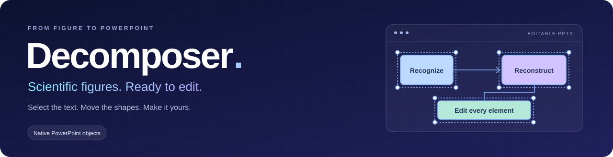
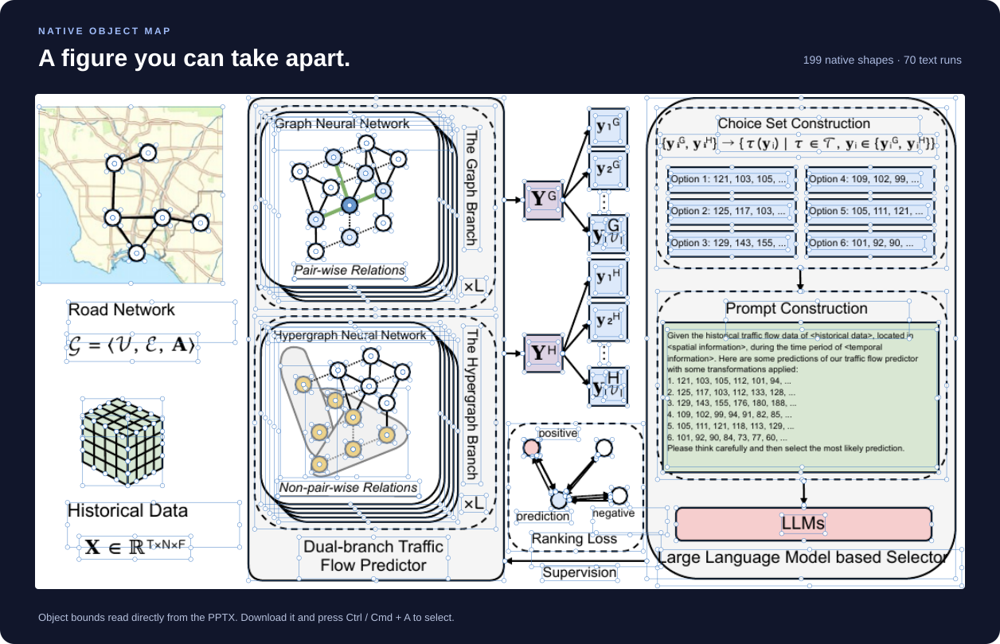

<p align="center"></p>

<p align="center"><a href="README.md">English</a> · <b>简体中文</b> · <a href="#docker-启动">一键启动</a> · <a href="app/examples/editable-demo.pptx">下载可编辑示例</a></p>

### 可以全选，更能逐个修改。

[](app/examples/editable-demo.pptx)

打开[示例 PPTX](app/examples/editable-demo.pptx)，点击幻灯片画布，按 **Ctrl / Cmd + A** 全选；文字、形状和连线都可以分别选中、移动和修改。

<details>
<summary>查看原图与重建结果</summary>

| 输入图片 | PPTX 重建结果 |
| :---: | :---: |
|  |  |

</details>


## Docker 启动

安装 Git、Docker 和 Docker Compose，然后执行：

```bash
git clone https://github.com/goya4140/Decomposer.git
cd Decomposer/app
cp .env.example .env
```

在 `.env` 中填写支持图片输入的模型 API：

```dotenv
DECOMPOSER_BASE_URL=https://your-provider.example/v1
DECOMPOSER_API_KEY=your-api-key
DECOMPOSER_MODEL=your-vision-model
```

API 地址不要包含 `/chat/completions`。如果服务商不支持 `json_schema`，设置 `DECOMPOSER_RESPONSE_MODE=json_object`。

启动：

```bash
./deploy.sh --docker
```

打开 [http://127.0.0.1:7860](http://127.0.0.1:7860)。

## 本机启动

安装 Python 3.12–3.13、Node.js 20+、LibreOffice、Poppler 和 Tesseract。按上面的方法配置 `.env`，然后执行：

```bash
./deploy.sh
```

打开 [http://127.0.0.1:7860](http://127.0.0.1:7860)。
